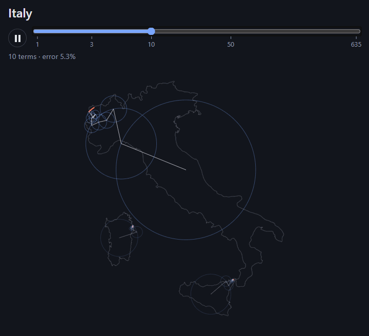
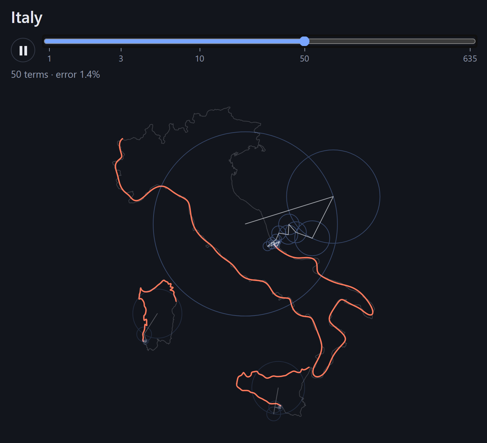
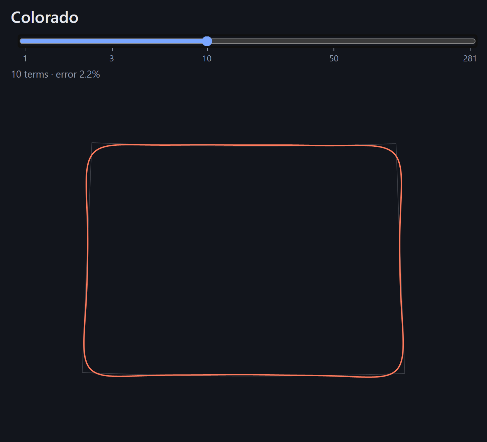
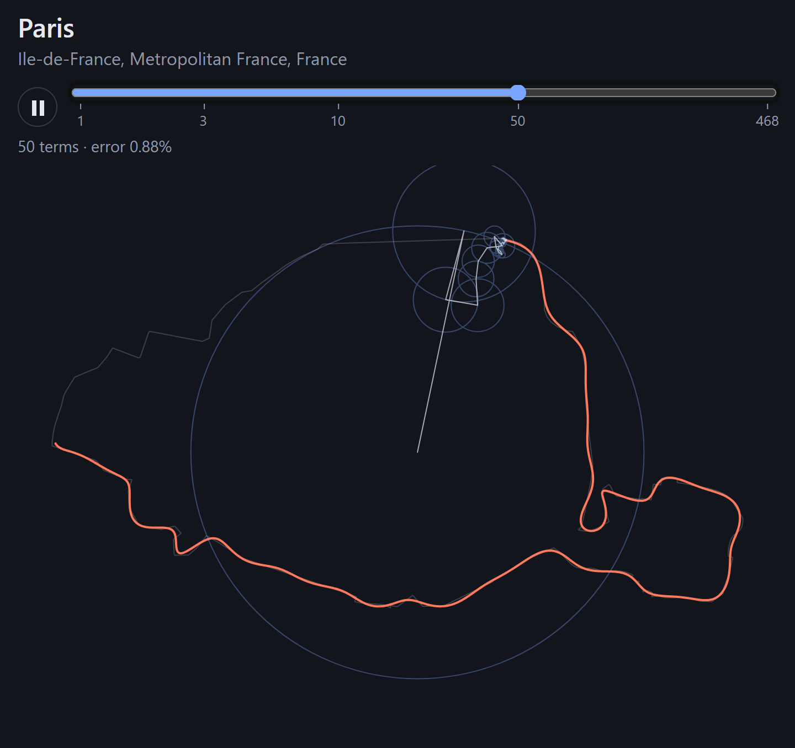
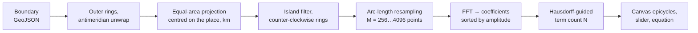

# Fourier Borders

Search for any country, state, city or town and watch its border drawn by spinning circles, from a single epicycle up to the number of terms needed to trace it within 0.1%.

<p align="center">
  
</p>

<p align="center">
  
  
  
</p>

### **[▶ Live demo: locationtransform.rodeanazari.dev](https://locationtransform.rodeanazari.dev)**

[](https://github.com/RodeanAzari/locationtransform/actions/workflows/ci.yml)
[](LICENSE)


## How it works

A closed curve in the plane can be written as a complex function of one parameter $t \in [0, 2\pi)$, and any such function has a Fourier series:

$$ z(t) = \sum_k c_k\, e^{ikt} $$

Each term $c_k e^{ikt}$ is an arrow of length $|c_k|$ that starts at angle $\arg c_k$ and turns $k$ times per lap. Chain the arrows tip to tail and they sweep out circles (epicycles); the tip of the last arrow traces the curve. With a few large terms you get a blob, and as smaller terms are added the coastline's bays and peninsulas appear.

For a selected place the app:



1. Takes the outer ring of each polygon, makes longitudes continuous across ±180°, and projects with an azimuthal equal-area projection centred on the place, in kilometres.
2. Drops tiny islands (under 0.5% of the area, keeping at most the 30 largest pieces).
3. Resamples each ring to M evenly spaced points by arc length. Raw vertices are unevenly spaced, which badly skews a discrete transform.
4. Runs an FFT to get the coefficients $c_k$ for $k = -M/2 \dots M/2-1$ and sorts them by amplitude, largest first. "n terms" means $c_0$ plus the n largest others.
5. Finds the smallest N whose reconstruction is within **0.1% of the place's size** (normalized Hausdorff distance), and lets you scrub from 1 to N terms.

Steps 3–5 are Rust compiled to WebAssembly, running in a Web Worker; everything else is TypeScript.

## Interesting problems solved

**No autocomplete on Nominatim.** OpenStreetMap's Nominatim geocoder has the polygons, but its usage policy forbids client-side autocomplete. Suggestions come from [Photon](https://photon.komoot.io/) instead, and Nominatim is called exactly once per place you open: through a client-side queue that keeps requests at least 1.1 s apart, identified with a contact address, and cached in IndexedDB, including "this place has no boundary" answers.

**The coastline paradox.** A coastline gets longer the finer you measure it, so "0.1% accurate" has to be relative to a specific dataset. The ground truth is Natural Earth 1:10m simplified per feature at 0.05% of √area (half the accuracy target, so simplification never dominates the error). Using area rather than the bounding box matters: Fiji's bounding box spans the whole globe.

**Normalized Hausdorff instead of energy.** The obvious accuracy measure, the share of spectral energy captured, says 99.9% long before the shape looks right: corners and inlets live in many small coefficients that carry almost no energy. The Hausdorff distance measures the worst visible deviation in either direction. It's normalized by the bounding-box diagonal of the _whole place_, so a 2 km islet in Canada doesn't demand thousands of terms. The error isn't monotone in n, so N is found by binary search followed by a forward scan with lookahead. Each evaluation is an inverse FFT plus a uniform-grid nearest-neighbour Hausdorff, which is O(M log M), so a 4096-point ring is analyzed in about 50 ms.

**Places made of many pieces.** Every kept ring gets its own series and its own $N_i$; the slider's N is the maximum, and each ring stops adding terms at its own $N_i$. Italy is drawn by three epicycle sets: mainland, Sicily and Sardinia.

**The antimeridian.** Russia, Fiji and the Aleutians cross ±180°. Longitudes are unwrapped per ring, and the projection is centred on the mean of the vertices' 3D unit vectors. Averaging longitudes directly would put Fiji's centre near 0°, on the far side of the planet, and the equal-area projection would tear it apart.

**Gibbs ringing on straight borders.** A corner's coefficients decay like $1/k^2$, so the error falls only like $1/n$. Colorado needs 281 terms, and at low n its corners round off and the edges ripple. A perfect square needs 101 terms; a circle needs exactly one. Both are unit tests.

**The TypeScript/Rust split.** The browser side (DOM, network, d3-geo projection, canvas) is TypeScript. The numerical core is a dependency-free Rust crate (hand-written radix-2 FFT, resampling, grid Hausdorff, findN), unit-tested natively with `cargo test` and shipped as a ~60 KB WebAssembly module. Only typed arrays cross the boundary. Projection stays in TypeScript because d3-geo is the best tool for it and Rust projection crates don't build cleanly for WASM.

## Tech stack

- **Rust → WebAssembly** (`wasm-bindgen`, `wasm-pack`): FFT, resampling, reconstruction, Hausdorff, term search.
- **TypeScript + Vite**, no UI framework; **Canvas 2D** (devicePixelRatio-aware); **d3-geo**; **KaTeX** (loaded on demand); a **Web Worker** for all analysis.
- **Vitest**, **ESLint** (type-checked rules), **Prettier**, `cargo fmt`/`clippy`.
- **mapshaper** for build-time data preprocessing.
- **Cloudflare Pages**, deployed by GitHub Actions.

## Architecture

```
crates/fourier-core/   Rust: resample, fft, series (sort + reconstruct), hausdorff, find_n → WASM
scripts/build-data.ts  Natural Earth download + mapshaper simplification → public/data/
src/
  config.ts            every tunable (accuracy target, island filter, sample counts, URLs)
  worker.ts            geo pipeline (TS) then fourier-core (WASM), off the main thread
  geo/                 outer rings, antimeridian unwrap, projection, island filter, orientation
  fourier/             worker client, types, path and epicycle evaluation, error readout
  search/              local index ranking, Photon client, Nominatim + rate limit, IndexedDB cache
  render/              canvas renderer: ghost outline, traced path, epicycles
  ui/                  search box, slider, place view + auto-play, equation panel, About
tests/                 Vitest unit tests
```

The TS ↔ WASM boundary is a single call, `analyzeRing(xy: Float64Array, options) → RingAnalysis`, whose getters return typed arrays. It is documented in [`crates/fourier-core/README.md`](crates/fourier-core/README.md).

## Running locally

Prerequisites: **Node 24**, **Rust stable** with the `wasm32-unknown-unknown` target, and **wasm-pack 0.15**.

```sh
rustup target add wasm32-unknown-unknown
cargo install wasm-pack

npm ci
npm run data      # download Natural Earth (cached in .cache/) and build public/data/ (~15 s)
npm run dev       # builds the WASM module, then starts Vite on http://localhost:5173
```

Checks:

```sh
cargo test                                   # Rust unit tests
wasm-pack test --node crates/fourier-core    # WASM smoke test
npm test                                     # Vitest
npm run typecheck && npm run lint
npm run build                                # production bundle in dist/
```

The generated data isn't committed; CI rebuilds it on every run. To build for a subpath, set `BASE_PATH` (e.g. `/locationtransform/`) for `npm run build` and `npm run preview`. On Windows, set it from PowerShell: Git Bash rewrites values that look like paths.

**Deployment.** Pushes to `main` that pass CI are deployed to Cloudflare Pages with `wrangler`. Cloudflare serves `.wasm` as `application/wasm`, and `public/_headers` marks Vite's content-hashed assets as immutable.

## Data sources and attribution

- Countries, states and provinces: [Natural Earth](https://www.naturalearthdata.com/) 1:10m (public domain).
- Cities and towns: © [OpenStreetMap contributors](https://www.openstreetmap.org/copyright), available under the ODbL, fetched from [Nominatim](https://nominatim.org/).
- Search: [Photon](https://photon.komoot.io/) by komoot.

## Known limitations and roadmap

- Holes and enclaves are ignored: South Africa is drawn without the gap for Lesotho.
- Small islands are filtered out; the page shows how many.
- Many towns are mapped in OpenStreetMap only as a point, so there's no border to draw.
- Islands split at 180° in the source data are drawn as two pieces; merging them is a possible next step.
- Possible next steps: drawing holes as their own epicycle sets, and exporting the animation as a video.

## License

[MIT](LICENSE)
